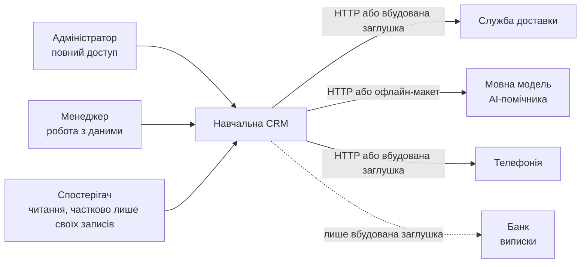
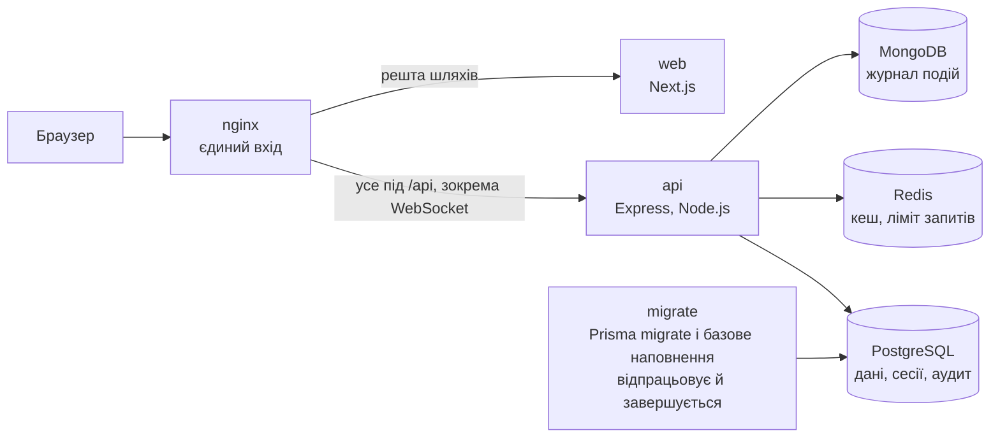
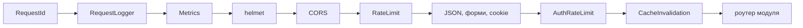
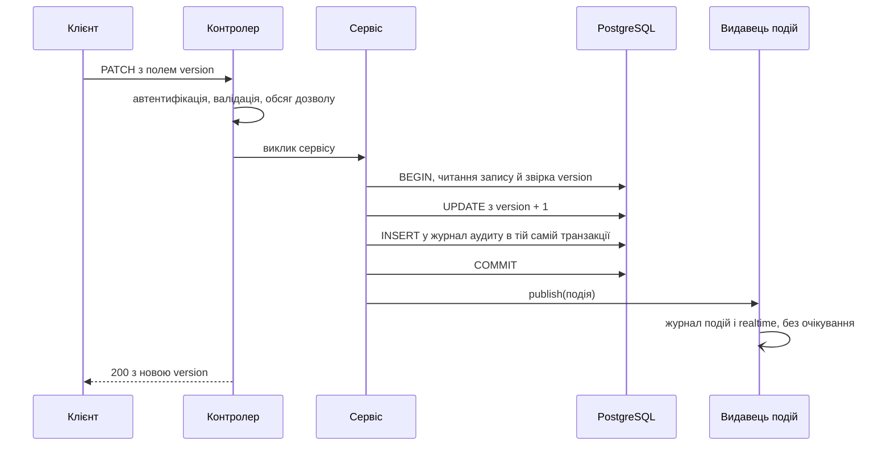
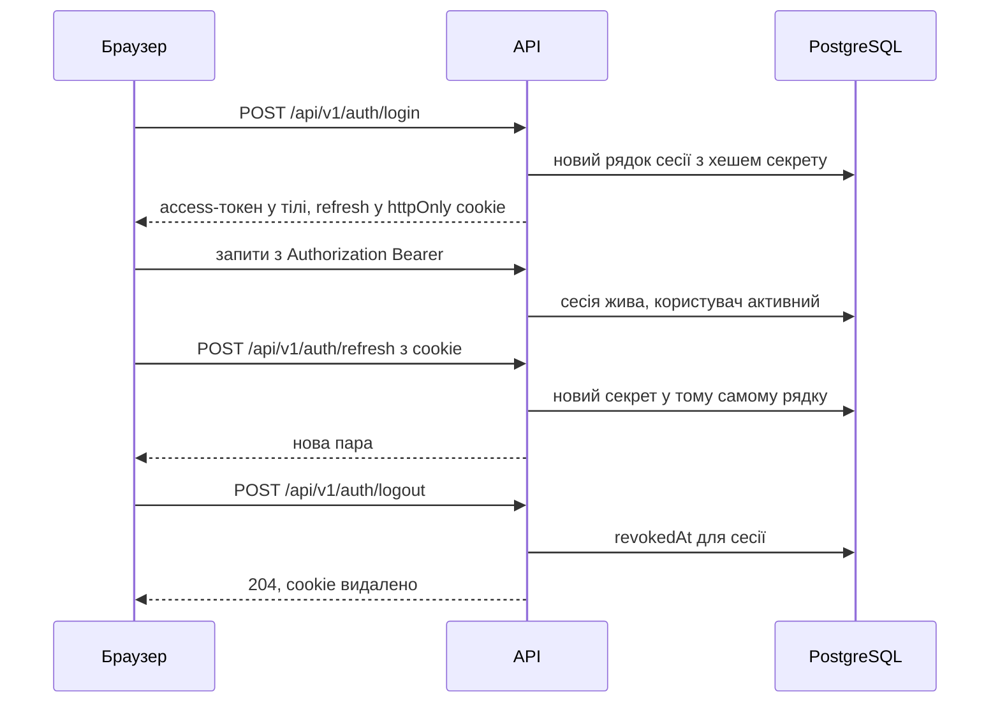

# Архітектура

Цей документ — карта країни, а не атлас. Він пояснює, з яких частин складається
система, де в коді шукати кожну з них і яких правил дотримується весь код. Що
саме робить окрема функція, підкаже сам код; цей файл підкаже, яку функцію
відкрити.

Як запустити систему — у [README.md](README.md). Щоденна робота з кодом, тести,
міграції й змінні оточення — у [docs/development.md](docs/development.md).
Чому рішення ухвалено саме так — в архітектурних рішеннях
[docs/adr/](docs/adr/README.md).

## Огляд з висоти

Навчальна CRM для невеликої торговельної компанії. Вона веде клієнтів і угоди,
каталог товарів, замовлення й склад, звернення клієнтів і журнал дзвінків,
банківські надходження та їх зведення із замовленнями, а поверх цього будує
звіти. Кожна зміна потрапляє в журнал аудиту, а користувачі, у яких відкрито
той самий розділ, бачать зміну без перезавантаження сторінки.

Користуються системою працівники компанії з різними правами: від повного
доступу до читання лише власних записів. Доступ описується дозволами виду
`ресурс:дія` з обсягом «усі записи» або «лише свої»; ролі — це набори таких
дозволів, і їх можна створювати, не змінюючи коду.

Технічно це веб-клієнт на Next.js, HTTP API на Express і TypeScript з Prisma та
три сховища: PostgreSQL для даних, Redis для кешу й обліку частоти запитів,
MongoDB для журналу доменних подій. Перед усім стоїть nginx.

## Контекст

Хто користується системою і з якими зовнішніми системами вона говорить.



Ролі на схемі — ті, що створює базове наповнення бази; облікові записи до них
перелічені в README. Інші ролі адміністратор створює через API.

Жодна зовнішня система не потрібна, щоб запустити систему й пройти всі
сценарії. Кожна інтеграція схована за інтерфейсом, і поруч лежить детермінована
заміна, яка відповідає тим самим форматом:

| Зовнішня система | Що з нею робить CRM | Без налаштування | Що вмикає справжній обмін |
|---|---|---|---|
| служба доставки | розрахунок вартості, створення відправлення, його статус | заглушка в `integrations/delivery/stub-transport.ts` | `DELIVERY_BASE_URL` |
| мовна модель | переказ угоди, класифікація звернення | офлайн-макет у `ai/mock-provider.ts` | `AI_ENDPOINT_URL` |
| телефонія | імпорт журналу дзвінків, запис розмови | заглушка в `calls/stub-provider.ts` | `CALL_PROVIDER_BASE_URL` |
| банк | імпорт виписки | заглушка в `finance/stub-provider.ts` | адаптера до справжнього банку немає |

Шляхи в таблиці — відносно `backend/src/modules/`. Змінна `INFRA_PROFILE=offline`
примусово вмикає заміни доставки й AI-помічника та кеш без Redis, хоч би що
стояло в інших змінних (`backend/src/infra-profile/index.ts`).

## Контейнери

Що працює, коли система запущена повністю (`npm run docker:all` або
`docker:prod`).



- **nginx** (`etc/nginx/nginx.conf`) — один порт назовні. Шляхи під `/api/`
  ідуть до `api`, окреме правило для `/api/v1/realtime` зберігає заголовки
  WebSocket, усе інше йде до `web`.
- **web** (`frontend/`) — зібраний Next.js. Клієнт завжди звертається до свого ж
  джерела за відносним шляхом `/api/...`; через nginx такий запит іде просто до
  `api`. Якщо відкрити `web` напряму, він сам пересилає `/api` на `api` через
  `rewrites` у `frontend/next.config.mjs`.
- **api** (`backend/`) — увесь HTTP API, документація, проби здоров'я, метрики
  й канал подій реального часу в одному процесі.
- **migrate** — образ бекенда, зібраний разом з інструментами розробки:
  накочує міграції (`prisma migrate deploy`) і запускає базове наповнення
  (`prisma/seed.ts`), після чого завершується. `api` стартує лише після його
  успіху.
- **PostgreSQL** — єдине джерело істини: бізнес-дані, користувачі, ролі, сесії,
  журнал аудиту.
- **Redis** — кеш і лічильники частоти запитів. Його втрата робить систему
  повільнішою, але не неправильною.
- **MongoDB** — журнал доменних подій із терміном зберігання. Доповнює аудит,
  але не замінює його.

Коли API запущено на машині (`local:api`), а клієнт — `local:web`, nginx не
бере участі: клієнт на порту 3000 пересилає `/api` на API через `rewrites` у
`frontend/next.config.mjs`.

## Карта коду

```
backend/
  src/
    server.ts            точка входу: конфігурація → корінь композиції → HTTP-сервер, WebSocket, зупинка
    composition-root.ts  корінь композиції: будує весь граф об'єктів один раз і монтує роутери
    openapi.ts           опис API з роутерів кореня композиції, без сервера й сховищ
    app/                 create-app.ts — конвеєр Express; health/ — проби live / startup / ready / info
    config/              env.ts — схема змінних оточення; load-env.cjs — .env і адреси сховищ; logger.ts
    infra-profile/       одне рішення «заміни чи справжні залежності»
    common/              спільне ядро без бізнес-логіки
    db/                  єдиний PrismaClient
    modules/<домен>/     доменні модулі
    events/              журнал доменних подій у MongoDB
    realtime/            WebSocket-шлюз і теми
    cache/               клієнт Redis і сервіс кешу
    test/                конфігурація й допоміжне для тестів
  prisma/                schema.prisma, migrations/, базове й демонстраційне наповнення
  scripts/               запуск Prisma CLI, генерація OpenAPI, скидання бази, раннер інтеграційних тестів
  tests/integration/     інтеграційні тести
  openapi.json           закомічений опис API
frontend/                веб-клієнт
etc/nginx/               конфігурація проксі
scripts/stack.mjs        реалізація команд npm run …
```

### Анатомія доменного модуля

Кожен модуль у `backend/src/modules/<домен>/` складений однаково, і читати його
варто в цьому порядку:

1. `router.ts` — HTTP-поверхня: шляхи через `describeRoutes()`,
   `authenticate`, перевірка запиту `validate(<zod-схема>)`, оголошені відмови
   `refusals(...)`, обробник контролера.
2. `controller.ts` — HTTP ↔ сервіс: бере `request.auth`, питає RBAC про обсяг
   дозволу, викликає сервіс і кладе результат у конверт `{ data }`.
3. `service.ts` — бізнес-правила: запити Prisma, транзакція, перевірка
   `version`, запис аудиту, оголошення події.
4. `validation.ts` — zod-схеми запиту (`body`, `params`, `query`); з них же
   генерується опис запиту в API.
5. `types.ts` — DTO відповіді як zod-схеми (з них — схеми відповідей в описі
   API) і TypeScript-типи.
6. `index.ts` — фасад: що модуль віддає назовні, зокрема
   `create<Домен>Router()`, `create<Домен>Controller()`, `create<Домен>Service()`.

Додаткові файли з'являються там, де в модуля є своя механіка:
`state.ts` / `transition.ts` — автомат станів, `money.ts` — арифметика сум,
`provider.ts` + `stub-provider.ts` / `http-provider.ts` / `retry-provider.ts` —
зовнішня система за інтерфейсом, `cache-keys.ts` — ключі кешу модуля.

Модулі не імпортують корінь композиції й самі не створюють ні кешу, ні
видавця подій, ні сервісів інших модулів: усе це вони отримують параметрами
фабрик (`AuditService`, `RbacService`, `DomainEventPublisher`, `CacheService`).
Журнал подій і WebSocket-шлюз модулям невідомі взагалі — вони лише підписники
видавця. Шлях монтування кожного роутера —
`/api/v1/<домен>` — задає `composition-root.ts`.

### Доменні модулі

| Модуль | Що робить | Звідки почати |
|---|---|---|
| `auth` | вхід, оновлення й завершення сесії, поточний користувач; дає іншим модулям middleware `authenticate` | `service.ts`, `middleware.ts` |
| `rbac` | ролі, дозволи `ресурс:дія` з обсягом, кеш дозволів; middleware `requirePermission` для роутерів | `service.ts`, `middleware.ts` |
| `users` | облікові записи, їхні ролі, деактивація, перегляд і відкликання сесій | `service.ts` |
| `contacts` | довідник людей і компаній, з якими працює організація | `service.ts` |
| `deals` | воронка продажів; стадія угоди змінюється лише окремою дією за правилами автомата | `transition.ts`, `state.ts`, `service.ts` |
| `products` | каталог товарів, з якого рахуються позиції замовлень | `service.ts` |
| `orders` | замовлення з позиціями й сумами; зміна статусу резервує, видає або повертає товар на складі | `transition.ts`, `stock.ts`, `money.ts`, `service.ts` |
| `warehouse` | склади, рівні запасів і журнал рухів; дає замовленням складські операції всередині їхньої транзакції (`createStockOperationsInTransaction`) | `service.ts` |
| `helpdesk` | звернення клієнтів; статус змінюється окремою дією, з історією переходів | `transition.ts`, `service.ts` |
| `calls` | журнал дзвінків: імпорт від провайдера телефонії, прив'язка до контакту чи угоди, запис розмови | `provider-factory.ts`, `service.ts` |
| `finance` | банківські виписки й транзакції, зведення надходжень із замовленнями, фінансовий підсумок | `matching.ts`, `service.ts` |
| `integrations` | доставка: розрахунок вартості, відправлення, статус; повтори й запобіжник від збоїв перевізника | `delivery/client.ts`, `delivery/factory.ts`, `service.ts` |
| `ai` | AI-помічник: переказ угоди й класифікація звернення | `provider-factory.ts`, `service.ts` |
| `settings` | налаштування організації: закритий реєстр ключів із типами й типовими значеннями | `registry.ts`, `service.ts` |
| `analytics` | звіти лише для читання поверх робочих таблиць і їх вивантаження; читаються через кеш | `service.ts`, `export/` |
| `audit` | журнал аудиту: запис у транзакції того, хто змінює, і читання історії | `service.ts` |

### Спільні частини

| Де | Що там |
|---|---|
| `src/config/env.ts`, `load-env.cjs` | єдина перевірена zod-схема конфігурації; читання `.env` і збирання адрес сховищ із частин |
| `src/common/errors/` | `AppError` — помилка зі статусом і кодом, з якої будується конверт помилки |
| `src/common/middleware/` | request id, лог запиту, `validate()`, ліміти частоти, скидання кешу, 404, обробник помилок |
| `src/common/openapi/` | `describeRoutes()`, `refusals()`, збирання й детермінована серіалізація документа |
| `src/common/money/` | арифметика грошей у цілих мінорних одиницях |
| `src/common/query/` | фільтри списків і посторінкова вибірка (`list-reader.ts`) |
| `src/common/reporting/` | звітне вікно за замовчуванням |
| `src/common/observability/` | реєстр і ендпоінт метрик Prometheus |
| `src/common/types/` | контекст автентифікації; `DomainEventSubject` — розсилка подій підписникам |
| `src/db/prisma.ts` | єдиний `PrismaClient` |
| `src/events/` | журнал подій у MongoDB з TTL і очищенням чутливих полів, проба готовності |
| `src/realtime/` | WebSocket-шлюз, автентифікація рукостискання, словник тем |
| `src/cache/` | клієнт Redis із префіксом ключів, сервіс кешу, що не ламає запит |
| `src/app/health/` | проби й фаза життєвого циклу процесу |

Шляхи в таблиці — відносно `backend/`.

### Тести

`backend/src/**/*.test.ts` — юніт-тести поруч із кодом (Jest): модулі й увесь
застосунок у процесі через `supertest`, без сховищ. Там же тести опису API
(`src/openapi.*.test.ts`). `backend/tests/integration/` — сценарії проти
справжніх PostgreSQL, Redis і MongoDB в окремих тестових базах; звичайний
`npm test` їх не збирає, для них є окрема команда.

### Веб-клієнт

`frontend/src/app/(auth)/<розділ>/` — розділи за входом, кожен з однаковим
набором: сторінка, `*.service.ts` (чистий HTTP), `*.queries.ts`
(TanStack Query), типи й валідація. `frontend/src/app/(non-auth)/` — вхід.
`frontend/src/shared/api/http.ts` — HTTP-клієнт із токеном у пам'яті й
оновленням сесії; `shared/realtime/` — клієнт каналу подій, який за подіями
скидає кеш запитів; `src/templates/` — оболонка, провайдери, навігація з
перевіркою прав.

## Потоки даних

### Шлях запиту

Middleware підключаються в `backend/src/app/create-app.ts` у тому порядку, в
якому запит їх проходить:



- **RequestId** — бере `X-Request-Id` клієнта, якщо він безпечний, або створює
  новий; той самий id потрапляє в кожен рядок логу, у заголовок і в тіло
  помилки.
- **RequestLogger** — pino-http, рядок на запит.
- **Metrics** — стоїть до всіх запобіжників, щоб у лічильники потрапили й
  відхилені запити.
- **helmet** — базові заголовки безпеки.
- **CORS** — дозволені джерела з `CORS_ORIGINS`, з cookie.
- **RateLimit** — вікно в Redis, загальний бюджет на кожен запит; ключ —
  адреса клієнта (IPv6 — за підмережею). Якщо Redis недоступний, запит
  пропускається. У середовищі `test` ліміти не підключаються.
- **JSON, форми, cookie** — розбір тіла з обмеженням `JSON_BODY_LIMIT`.
- Далі обслуговуються проби `/api/health/...` і, якщо ввімкнено, опис API
  `/api/docs` та `/api/openapi.json`.
- **AuthRateLimit** — менший бюджет на `/api/v1/auth`.
- **CacheInvalidation** — після успішного запису скидає кеш звітів (див. нижче).

Далі роутер модуля проганяє ланцюжок маршруту: `authenticate` (`request.auth`),
`validate()` (помилка — 400 `VALIDATION_ERROR`), обробник контролера. Право
перевіряється в одному з двох місць. Доменні модулі питають
`rbacService.getPermissionScope()` у контролері й передають обсяг сервісу.
Адміністративні й звітні роутери (`users`, `rbac`, `settings`, `analytics`)
ставлять `requirePermission` прямо в ланцюжок. Express 5 сам передає помилку
асинхронного обробника далі, тож модулі просто кидають `AppError`; обробник
з `common/middleware/error-handler.ts` перетворює її на єдиний конверт помилки.
Після роутерів стоять `/api/metrics` (лише з `METRICS_TOKEN`) і 404.

### Запис: транзакція, аудит, подія після commit



1. Сервіс відкриває транзакцію `db.$transaction(...)` (зразок —
   `backend/src/modules/products/service.ts`). Виняток усередині означає відкат
   усього.
2. Сервіс перевіряє `version`, яку прислав клієнт, і оновлює запис з умовою на
   ту саму версію; розбіжність — 409 з кодом `<РЕСУРС>_CONCURRENT_MODIFICATION`.
3. Запис аудиту (`AuditService.record()` з `modules/audit/service.ts`) іде на
   тій самій транзакції, тож зміна й її слід комітяться або відкочуються разом.
4. Подію сервіс публікує лише після того, як транзакція закомічена. Відкочена
   транзакція подій не породжує.
5. `DomainEventSubject` (`common/types/domain-event-publisher.ts`) розсилає
   подію підписникам, зареєстрованим у `composition-root.ts`: журнал MongoDB і
   WebSocket. `publish()` нічого не чекає й нічого не кидає, кожен підписник
   ізольований, тож збій підписника не доходить до клієнта, чия транзакція вже
   закомічена.

Замовлення — складніший випадок того самого: перехід статусу змінює
замовлення, рівні запасів і журнал рухів однією транзакцією (`orders/stock.ts`
і складський порт `warehouse`), а події про замовлення й склад ідуть після неї.

### Читання звітів через кеш

Сервіс аналітики (`modules/analytics/service.ts`) будує звіт через
`cache.remember(key, ttl, ...)`: є значення в Redis — віддає його, немає —
рахує запит до PostgreSQL і кладе результат на `CACHE_TTL_SECONDS`. Ключ
містить назву звіту й нормалізовані параметри (`modules/analytics/cache-keys.ts`).

Скидання грубе й навмисне: `createCacheInvalidation`
(`common/middleware/cache-invalidation.ts`) після кожного успішного `POST`,
`PUT`, `PATCH` чи `DELETE` (крім `/api/v1/auth`) видаляє весь простір ключів
аналітики, і робить це до того, як відповідь піде клієнту. Відстежувати, який
запис впливає на який звіт, не потрібно, а клієнт, що читає одразу після свого
запису, не побачить старих чисел.

Інші кеші скидаються адресно в сервісах: дозволи користувача — під час зміни
ролей і користувачів (`rbac/service.ts`, `users/service.ts`), налаштування
організації — під час їх запису (`settings/service.ts`).

Сервіс кешу (`src/cache/cache.service.ts`) ніколи не кидає винятків: помилка
читання — це промах, помилка запису — пропущений запис.

### Підписка на події реального часу

1. Клієнт відкриває WebSocket на `WS_PATH` (типово `/api/v1/realtime`). Токен
   доступу передається підпротоколом `bearer, <токен>` або заголовком
   `Authorization`; рядок запиту не читається ніколи (`src/realtime/auth.ts`).
2. Шлюз (`src/realtime/gateway.ts`) перевіряє токен тим самим
   `authService.authenticate()`, що й HTTP, ще до рукостискання; без дійсного
   токена відповідає 401 і закриває з'єднання.
3. Клієнт надсилає `{"type": "subscribe", "topic": "..."}`. Тема — це або
   колекція (`deals`, `orders`), або окремий запис `entity:<тип>:<id>`
   (`src/realtime/topics.ts`). Невідома назва — помилка `UNKNOWN_TOPIC`.
4. `canSubscribe` у `composition-root.ts` визначає ресурс теми
   (`topicPermissionRequirement()`) і вимагає дозволу `read` на нього. Сам шлюз
   RBAC не імпортує.
5. Закомічена зміна йде в тему колекції та в тему запису; клієнт за подією
   скидає відповідні запити й перечитує дані через HTTP.

Реєстр підписок живе в пам'яті процесу.

## Сесії та автентифікація



- **Вхід** (`modules/auth/service.ts`). Відсутній користувач, невірний пароль
  і деактивований обліковий запис дають однакову відповідь 401
  `INVALID_CREDENTIALS`. Успіх створює рядок у таблиці сесій і повертає профіль
  з ролями й дозволами.
- **Access-токен** — JWT на 15 хвилин, підписаний `JWT_ACCESS_SECRET`, з
  ідентифікаторами користувача й сесії. Клієнт тримає його лише в пам'яті
  (`frontend/src/shared/api/http.ts`), не в `localStorage`. На кожен запит
  `authenticate` перевіряє не тільки підпис, а й те, що сесія не відкликана й не
  прострочена, а користувач активний, — тому вихід і відкликання діють одразу, а
  не після закінчення токена.
- **Refresh-токен** — непрозорий рядок `<id сесії>.<секрет>`; у базі лежить
  лише bcrypt-хеш секрету. Він живе 7 днів у cookie `refresh_token` з `httpOnly`,
  `SameSite=Lax`, шляхом `/api/v1/auth` і прапорцем `Secure` у production. До
  звичайних запитів cookie не додається, а скрипт на сторінці прочитати його не
  може. Строки обох токенів задає `createAuthConfig()` у `composition-root.ts`.
- **Ротація.** `refresh` записує новий секрет і новий строк у той самий рядок
  сесії. Старий refresh-токен перестає працювати, щойно законний власник
  оновився; кількість сесій від оновлень не росте. Клієнт, отримавши 401,
  оновлює сесію один раз для всіх паралельних запитів і повторює запит, а після
  перезавантаження сторінки відновлює сесію з cookie.
- **Вихід** ставить сесії `revokedAt` і видаляє cookie. Вихід без дійсного
  токена — не помилка.
- **Відкликання.** Адміністратор бачить сесії користувача й відкликає будь-яку
  з них (`users/router.ts`). Деактивація користувача відкликає всі його сесії в
  тій самій транзакції й скидає кеш дозволів.

### RBAC × обсяг

Дозвіл — це пара `ресурс:дія` (`products:write`, `ai:use`), яку роль видає з
обсягом `ALL` або `OWN` (`PermissionScope` у `prisma/schema.prisma`). У
користувача може бути кілька ролей; з однакових дозволів перемагає `ALL`.
Дозволи користувача кешуються в Redis і скидаються під час зміни ролей.

`rbacService.getPermissionScope()` (`modules/rbac/service.ts`) повертає обсяг
або `null`, коли дозволу немає зовсім; контролер доменного модуля на `null`
відповідає 403, а обсяг передає сервісу. Звузити вибірку до власних записів
може тільки сервіс, бо лише він знає, хто власник запису: він додає умову на
`ownerId` у запит або відмовляє в зміні чужого запису. Тобто перевірка права
відбувається в контролері, а застосування обсягу — у сервісі, і забути другу
половину — найпростіший спосіб відкрити чужі записи. `requirePermission`
(`modules/rbac/middleware.ts`) пропускає `OWN`, лише коли маршрут уміє назвати
власника запису; інакше відповідає 403.

## Наскрізні інваріанти

- **Один конверт.** Успіх — `{"data": ...}`, сторінка списку —
  `{"data": {"items", "page", "pageSize", "total"}}`, помилка —
  `{"error": {"code", "message", "details"}, "requestId"}`. Помилки, зокрема
  404 невідомого маршруту й 429 ліміту, збирає один обробник із `AppError`.
- **Гроші — десятковими рядками.** У базі `Decimal` з точністю до копійки,
  арифметика — у цілих мінорних одиницях (`common/money`), у JSON рядок
  `"1250.00"`. `number` сум не торкається ніде.
- **Оптимістичне блокування.** Записи, які люди редагують одночасно, мають
  `version`; кожна зміна приходить з версією, яку бачив клієнт, і збільшує її.
  Невідповідність — 409. Видалення такого запису передає версію в рядку запиту.
- **М'яке видалення.** Видалення ставить `deletedAt`; такі записи зникають зі
  списків і звітів, але лишаються для історії та зв'язків.
- **Аудит у тій самій транзакції.** Сервіс, що пише слід, пише його у своїй
  транзакції; слід і зміна не можуть розійтися.
- **Події — тільки після commit.** Підписники ніколи не чують про зміну, яку
  потім відкотили, і не можуть зламати закомічену операцію.
- **Стани змінюються окремою дією.** Стадія угоди, статус замовлення й
  звернення не редагуються як звичайне поле: для них є окремий маршрут
  `/transitions` і автомат дозволених переходів.
- **Деградовані залежності.** Redis і MongoDB не роблять запис неможливим.
  Недоступний кеш — промах і повільніший запит; недоступний Redis для ліміту —
  запит пропускається; недоступний журнал подій — подія губиться для журналу, а
  операція й аудит лишаються. На старті API не падає через MongoDB. Проба
  `/api/health/ready` при цьому чесна: кеш у ній некритичний (статус
  `degraded`, HTTP 200), а журнал подій і база критичні (HTTP 503).
- **Одне місце конфігурації.** Змінні оточення застосунку перевіряє лише
  `loadConfig()` (`src/config/env.ts`); невалідне значення зупиняє старт із
  переліком помилок, а не ламає запит пізніше. Виняток — пароль наповнення, який
  читають лише скрипти `prisma/seed.ts` і `prisma/demo-seed.ts`.
- **Залежності спрямовані всередину.** Модулі не імпортують корінь композиції;
  зовнішні системи доступні тільки через інтерфейс, який реалізують і справжній
  адаптер, і заміна.

### Чого система свідомо не робить

- Немає справжнього production: розгортання в CI — імітація на тимчасовій машині
  ([docs/deployment.md](docs/deployment.md)).
- Немає черги повідомлень. Події доставляються в межах процесу без гарантії
  доставки; надійна історія змін — журнал аудиту в PostgreSQL.
- Журнал подій не читається через API: це сховище для розбору, а не джерело
  для екранів.
- Канал реального часу тримає підписки в пам'яті одного процесу.
- Немає реєстрації, відновлення пароля, листів і SMS. Облікові записи створює
  адміністратор.
- Немає фонових задач за розкладом: усе відбувається у відповідь на запит.
- Немає справжнього обміну з банком — лише вбудована виписка.
- Одна організація на інсталяцію.

## Опис API (OpenAPI)

Опис генерується з коду, а не пишеться руками:

- **Маршрут і його опис — один виклик.** Роутер реєструє маршрути через
  `describeRoutes(router, tags)` (`src/common/openapi/routes.ts`):
  `routes.patch(path, опис, ...обробники)` передає обробники в Express так само,
  як `router.patch(...)`, і запам'ятовує опис поруч. Документ потім збирається
  обходом роутерів, які застосунок справді змонтував.
- **Запит — зі схеми, яку перевіряє `validate()`.** Схема запиту не
  повторюється: її читають з `validate(<схема>)` у ланцюжку обробників. Схема
  успішної відповіді — zod-DTO з `types.ts` модуля (`ok(...)`, `created(...)`,
  `pageOf(...)`, `noContent(...)`).
- **Відмови — руками, поруч із маршрутом.** Чим може відмовити сервіс (401,
  403, 404, 409 …), генератор знати не може: це винятки глибоко в коді. Тому
  кожен маршрут перелічує їх сам через `refusals(...)`, і рецензент бачить шлях
  і його відмови поруч. Тексти статусів живуть у `RESPONSE_DESCRIPTIONS`
  (`src/common/openapi/refusals.ts`).
- **Спільне додається за правилом.** 400 (для операцій під `/api/v1`) і 500 з
  конвертом помилки документ додає до кожної операції сам.
- **Закомічений `backend/openapi.json`.** Його пише `npm run openapi:generate`
  (з теки `backend`) через `src/openapi.ts` — з роутерів кореня композиції, без
  сервера й сховищ, з фіксованими налаштуваннями, тож файл однаковий на кожній
  машині. `src/openapi.drift.test.ts` падає, якщо файл розійшовся з кодом або з
  тим, що віддає `/api/openapi.json`; `src/openapi.routes.test.ts` — якщо
  змонтовано маршрут без опису (звичайним `router.get(...)`);
  `src/openapi.refusals.test.ts` ловить пропущені відмови, які мають механічну
  ознаку.
- **Swagger UI** — `/api/docs`, документ — `/api/openapi.json`. Обидва
  вимикаються в production, якщо явно не задано `API_DOCS_ENABLED=true`.

## Середовища

`APP_ENV` має три значення, і кожне змінює поведінку в кількох конкретних
місцях. `NODE_ENV` окремо не задають: `load-env.cjs` копіює в нього `APP_ENV`.

| | `development` | `test` | `production` |
|---|---|---|---|
| Де | `local:api`; `docker:all` (через `compose.override.yaml`) | Jest: юніт-тести беруть `src/test/config.ts`, інтеграційні виводять налаштування з `.env` | `docker:prod` (лише `compose.yaml`), імітоване розгортання в CI |
| Логи | у `local:api` — кольорові, для людини | вимкнені (`silent`) | JSON, рядок на подію |
| SQL у лог | так | ні | ні |
| Перезапуск при збереженні | так | — | ні, зібраний образ |
| Swagger і `/api/openapi.json` | так | так | ні, якщо не `API_DOCS_ENABLED=true` |
| Текст неочікуваної помилки 500 | повідомлення винятку | повідомлення винятку | лише «Internal server error» |
| Cookie сесії `Secure` | ні | ні | так |
| Ліміт частоти запитів | так | ні | так |
| Базове наповнення | так | так | лише з `SEED_ALLOW_PRODUCTION=true` |

Звідки береться конфігурація:

- **`.env` у корені** — спільне для Docker Compose і для API на машині:
  середовище, порти, назви й паролі баз.
- **`backend/.env`** — лише бекенд: секрети, CORS, ліміти, кеш, інтеграції.
- **`compose.yaml`** описує систему так, як вона працювала б на сервері, і
  ставить `APP_ENV=production` та імена сервісів як хости сховищ.
  **`compose.override.yaml`** поверх нього перемикає `api` і `migrate` у
  `development` і монтує код.
- Тестового файла оточення немає: інтеграційні тести беруть ті самі `.env` і
  самі виводять тестові бази `<назва>_test` та префікс Redis `crm-test:`.

Повна таблиця змінних — у [docs/development.md](docs/development.md#змінні-оточення).

## Глосарій

| Термін | Що означає тут |
|---|---|
| контакт | людина або компанія, з якою працює організація |
| угода | потенційний продаж; рухається стадіями `LEAD` → `QUALIFIED` → `PROPOSAL` → `WON` або `LOST` |
| власник запису | працівник, відповідальний за угоду, контакт, замовлення; від нього залежить обсяг `OWN` |
| товар | позиція каталогу з артикулом (SKU) і ціною |
| замовлення | продаж із позиціями; статуси `DRAFT` → `CONFIRMED` → `PAID` → `FULFILLED`, а `CANCELLED` — з будь-якого статусу до видачі |
| позиція замовлення | рядок замовлення: товар, кількість, ціна |
| склад за замовчуванням | склад, з якого працюють замовлення; налаштування організації `warehouse.defaultCode` |
| рівень запасу | скільки товару є на складі і скільки з того зарезервовано |
| рух запасу | запис у журналі складу: надходження, видача, резерв, зняття резерву, коригування |
| резерв | товар, обіцяний підтвердженому замовленню; знімається скасуванням або перетворюється на видачу |
| звернення | запит клієнта до підтримки з каналом, пріоритетом і статусом `NEW` … `CLOSED` |
| дзвінок | запис журналу телефонії; факти дає провайдер, люди додають зв'язок із контактом чи угодою |
| виписка | банківський звіт за період, імпортований як ціле |
| транзакція | рядок виписки: надходження або списання |
| зведення | зв'язок надходження із замовленням, яке воно оплачує; буває ручним і автоматичним, а стан `SUGGESTED` означає кандидата, якого має підтвердити людина |
| налаштування організації | ключ із закритого реєстру з типом і типовим значенням |
| звітне вікно | період, який звіт бере, коли параметри дат не задано |
| дозвіл | право `ресурс:дія`, видане роллю |
| обсяг | ширина дозволу: `ALL` — усі записи, `OWN` — лише свої |
| роль | названий набір дозволів з обсягами |
| сесія | рядок у базі, до якого прив'язані refresh- і access-токени; її можна відкликати |
| access-токен | короткоживучий JWT для заголовка `Authorization` |
| refresh-токен | довгоживучий непрозорий токен у httpOnly cookie, яким оновлюють пару |
| версія (`version`) | лічильник змін запису для оптимістичного блокування |
| м'яке видалення | позначка `deletedAt` замість фізичного видалення |
| журнал аудиту | історія змін у PostgreSQL: хто, що, коли, до й після; пишеться в транзакції зміни |
| доменна подія | повідомлення «запис змінено», яке розсилається після commit |
| журнал подій | сховище доменних подій у MongoDB з терміном зберігання |
| тема | канал підписки WebSocket: колекція (`deals`) або запис (`entity:deal:<id>`) |
| конверт | обов'язкова зовнішня форма відповіді: `data` або `error` з `requestId` |
| відмова | оголошена в описі API відповідь 4xx/5xx маршруту з кодом помилки |
| заглушка, макет | детермінована заміна зовнішньої системи, яка працює без мережі |
| інфраструктурний профіль | `INFRA_PROFILE`: `offline` вмикає заміни разом |
| запобіжник (circuit breaker) | після серії збоїв перевізника тимчасово перестає до нього звертатися |
| корінь композиції | `composition-root.ts`: єдине місце, де модулі з'єднуються між собою й з інфраструктурою |

## Що читати далі

- [README.md](README.md) — запуск, команди, адреси, облікові записи.
- [docs/development.md](docs/development.md) — локальна розробка, тести,
  міграції, демонстраційні дані, змінні оточення.
- [docs/deployment.md](docs/deployment.md) — ланцюжок релізу й імітоване
  розгортання.
- [docs/adr/](docs/adr/README.md) — архітектурні рішення та їх причини.
- [CONTRIBUTING.md](CONTRIBUTING.md) — як запропонувати зміну.
