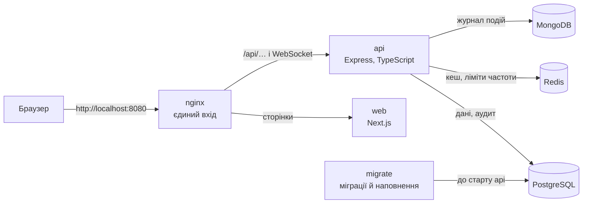

# Навчальна CRM

CRM для невеликої торговельної компанії. Компанія продає товари зі своїх
складів, і система веде клієнта від першого контакту до оплаченого й
виконаного замовлення: хто з ким говорив, що пообіцяли, що зарезервовано на
складі, чи надійшли гроші, що питав клієнт після покупки.

## Хто з нею працює

| Роль | Що робить |
|---|---|
| адміністратор | усе, зокрема користувачі, ролі, налаштування й фінансові операції |
| менеджер | щоденна робота: клієнти, угоди, замовлення, склад, звернення, дзвінки; фінанси, аналітику й аудит переглядає |
| спостерігач | лише перегляд, і лише записів, закріплених за ним; каталог і залишки бачить повністю |

Ролі не зашиті в код: адміністратор створює нові й видає їм права, кожне — з
областю «усі записи» або «лише свої».

## Що вона вміє

| Область | Що в ній роблять |
|---|---|
| Контакти | ведуть клієнтів: ім'я, компанія, пошта, телефон, нотатки; у кожного запису є відповідальний |
| Угоди | ведуть продаж воронкою: лід → кваліфікований → пропозиція → виграна чи програна, з імовірністю успіху |
| Товари й склад | каталог товарів, склади, залишки; надходження, видача, резерв, зняття резерву, коригування й історія рухів |
| Замовлення | від чернетки через підтвердження й оплату до виконання; підтвердження резервує товар, скасування повертає резерв |
| Фінанси | імпорт банківської виписки й зіставлення вхідних платежів із замовленнями |
| Доставка | розрахунок вартості й оформлення відправлень через службу доставки |
| Звернення | заявки клієнтів у службу підтримки: пріоритет, виконавець, статус від нового до закритого |
| Дзвінки | журнал дзвінків із телефонії, записи розмов, прив'язка дзвінка до контакту чи угоди |
| Аналітика | продажі, воронка угод, найпопулярніші товари, результати менеджерів, стан залишків; вивантаження в CSV |
| AI-помічник | коротке резюме угоди й визначення теми вхідного звернення |
| Аудит | журнал змін: хто, що і коли змінив |
| Користувачі й доступ | облікові записи, їхні сесії, ролі й права |
| Налаштування | параметри застосунку |

Відкриті таблиці оновлюються самі, коли дані змінює хтось інший: API
повідомляє клієнт про кожну зміну каналом реального часу.

Технічно система складається з веб-клієнта (`frontend/`), HTTP API на Node.js
(`backend/`) і трьох сховищ: PostgreSQL, Redis і MongoDB. Сховища завжди
працюють у Docker. API і клієнт можна запускати в Docker або на машині, разом
або окремо. Як частини пов'язані між собою — розділ «Архітектура» нижче; як
запропонувати зміну — [CONTRIBUTING.md](CONTRIBUTING.md).

## Вимоги

- Docker Desktop (або Docker Engine) з Docker Compose v2.
- Node.js 22 — для команд `npm run …` і для запуску API та клієнта на машині.

Без Node.js стек теж запускається, через bash-скрипти або напряму через Docker
Compose — див. «Без обгорток» нижче.

## Швидкий старт

```bash
npm run setup        # створює файли .env з новими секретами й перевіряє порти
npm run docker:all   # збирає й піднімає всю систему, чекає, поки вона стане здоровою
```

Відкрий **http://localhost:8080**. Перший запуск займає кілька хвилин через
збірку образів, наступні — секунди. Зупинити — `npm run docker:stop`. Команди
працюють у PowerShell, cmd, bash і zsh.

## Команди

| Команда | Що робить |
|---|---|
| `npm run setup` | один раз після клону: створює `.env` і `backend/.env` з новими секретами, показує зайняті порти, ставить хук перед комітом |
| **На машині** | зупиняються `Ctrl+C` у своєму терміналі |
| `npm run local:install` | поставити залежності бекенда й клієнта — потрібно для `local:*`, `test` і `check` |
| `npm run local:api` | `docker:db`, потім API на машині на порту 8000; перезапускається при збереженні файла |
| `npm run local:web` | веб-клієнт на машині на порту 3000, з гарячим перезавантаженням |
| **У Docker** | працюють у фоні, зупиняються `docker:stop` |
| `npm run docker:db` | PostgreSQL, Redis і MongoDB, плюс міграції й базове наповнення |
| `npm run docker:api` | `docker:db` плюс API; API перезапускається при збереженні файла |
| `npm run docker:all` | `docker:api` плюс веб-клієнт і nginx — уся система, режим розробки |
| `npm run docker:prod` | уся система з production-образів — так, як вона працювала б на сервері |
| `npm run docker:build` | лише зібрати production-образи, нічого не запускаючи |
| `npm run docker:stop` | зупинити все, що цей стек запустив у Docker; дані лишаються |
| `npm run docker:clean` | зупинити все й видалити бази (питає підтвердження) |
| `npm run docker:logs` | логи всіх контейнерів; `npm run docker:logs -- api` — одного |
| `npm run docker:ps` | стан кожного контейнера |
| `npm run docker:portainer` | Portainer: контейнери, їхні логи й стан у браузері |
| **База** | |
| `npm run db:migrate` | застосувати міграції й базове наповнення ще раз |
| `npm run db:seed:demo` | завантажити великий демонстраційний набір даних |
| **Перевірки** | |
| `npm test` | юніт-тести бекенда й веб-клієнта |
| `npm run test:integration` | інтеграційні тести бекенда проти сховищ `docker:db` |
| `npm run check` | перевірки коду з CI: формат, лінт, типи, юніт-тести, збірка |
| `npm run check:api` | те саме лише для бекенда; `check:web` — лише для клієнта |

## Запуск частинами

Docker-команди вкладені одна в одну: `docker:api` спершу виконує `docker:db`,
`docker:all` — `docker:api`. Так само `local:api` спершу виконує `docker:db`.
Те, що вже запущено, не перезапускається, тож більша команда поверх меншої
займає секунди.

| Що правиш | Що запускати |
|---|---|
| нічого, лише дивишся | `docker:all` → http://localhost:8080 |
| бекенд | `local:api` → http://localhost:8000/api/docs |
| бекенд і клієнт | `local:api` і в другому терміналі `local:web` → http://localhost:3000 |
| лише клієнт | `docker:api`, потім `local:web` → http://localhost:3000 |
| нічого, перевірити production-збірку | `docker:prod` → http://localhost:8080 |

Клієнт на машині пересилає запити `/api` на `http://127.0.0.1:8000`, і йому
байдуже, хто там слухає: контейнер `api` чи API на машині. Тому одночасно на
8000 працює щось одне. `local:api` перевіряє порт заздалегідь і не стартує,
якщо його вже тримає контейнер, — тоді спершу `docker:stop`.

Зупинка теж двох видів. API і клієнт на машині — `Ctrl+C` у їхньому терміналі;
сховища при цьому лишаються працювати. Усе докерне — однією `docker:stop`,
хоч би якою командою його запускали.

## Два режими стека

| | `docker:all` (розробка) | `docker:prod` (як на сервері) |
|---|---|---|
| Файли compose | `compose.yaml` + `compose.override.yaml` | лише `compose.yaml` |
| API | код монтується з `backend/`, перезапуск при збереженні | зібраний образ, без вихідного коду |
| Веб-клієнт | production-збірка | production-збірка |
| Середовище застосунку | `development` | `production` |

`compose.yaml` описує систему так, як вона працює на сервері.
`compose.override.yaml` додає поверх неї режим розробки, і `docker compose`
підхоплює його сам, коли файл лежить поруч.

`docker:prod` щоразу добудовує те, що змінилося; якщо код не мінявся, збірка
займає секунди. Веб-клієнт в обох режимах зібраний — так стек займає сотні
мегабайт пам'яті, а не гігабайти. Щоб правити клієнт із гарячим
перезавантаженням, запусти його на машині: `local:web`.

Production-стек — навчальний стенд, тому базове наповнення з обліковими
записами нижче працює й у ньому. Дозволяє це `SEED_ALLOW_PRODUCTION=true` у
`backend/.env`; без цього рядка наповнення в production відмовляється
запускатися.

## Тести й перевірки

| Що | Команда | Що потрібно |
|---|---|---|
| юніт-тести | `npm test` | залежності на машині: `npm run local:install` |
| перевірки коду з CI | `npm run check` | те саме |
| інтеграційні тести бекенда | `npm run docker:db`, потім `npm run test:integration` | запущені сховища |

`check` запускає рівно ті скрипти, що й перевірки бекенда й клієнта в CI, тож
зелений `check` на машині означає, що й вони будуть зелені. Решту CI запускає
окремо: інтеграційні тести (на машині — `test:integration`), звірку міграцій зі
схемою й збірку production-образів (`docker:build`).

`npm test` сховищ не торкається: інтеграційні набори в нього не входять і
названі окремим рядком у кінці прогону.

Інтеграційні тести працюють з окремими базами в тих самих контейнерах, тож
робочих даних не чіпають. Окремого файла оточення для тестів немає: раннер бере
хост, порт, користувача й пароль з тих самих `.env` і сам виводить тестове
оточення:

| Що | Значення в тестах |
|---|---|
| `APP_ENV` | `test` |
| PostgreSQL | той самий сервер, база `${POSTGRES_DB}_test` (типово `practice_crm_test`) |
| MongoDB | той самий сервер, база `${MONGO_DB}_test` (типово `practice_events_test`) |
| Redis | той самий сервер, ключі з префіксом `crm-test:` |
| Секрети | фіксовані тестові, а не ті, що в `.env` |

Тестову базу PostgreSQL раннер створює сам, один раз застосовує міграції, а
перед кожним набором скидає й наповнює базу заново. Робочих `DATABASE_URL`,
`REDIS_URL` і `MONGODB_URL` він не бере ніколи. Явні `DATABASE_URL_TEST`,
`REDIS_URL_TEST` і `MONGODB_URL_TEST` мають пріоритет — так адреси задає CI.
Назва тестової бази мусить містити окреме слово `test` або `testing`, інакше
раннер відмовляється працювати.

Контейнери тести не запускають. Якщо сховище не відповідає, команда падає з
ненульовим кодом, називає сховище й адресу та підказує `docker:db`. Новий
файл `backend/tests/integration/*.integration.test.ts` потрапляє в прогін сам.

**Хук перед комітом.** `setup` ставить git-хук (husky і lint-staged): перед кожним
комітом він форматує й лінтить лише ті файли, що йдуть у коміт. Тести хук не
запускає — для них `check`. Виправлене форматування хук сам додає в коміт; помилку
лінтера, яку не виправити автоматично, він показує й зупиняє коміт. Разово обійти
хук — `git commit --no-verify`; CI однаково перевірить те саме.

## Облікові записи

Пароль для всіх трьох — значення `SEED_USER_PASSWORD` з `backend/.env`;
`docker:all` і `docker:prod` друкують його наприкінці.

| Пошта | Роль |
|---|---|
| `admin@crm-training.example` | повний доступ |
| `manager@crm-training.example` | робота з даними |
| `viewer@crm-training.example` | лише читання, і лише своїх записів |

## Адреси

| Адреса | Що це |
|---|---|
| http://localhost:8080 | застосунок через nginx (`docker:all`, `docker:prod`) |
| http://localhost:3000 | веб-клієнт напряму (`local:web` або контейнер `web`) |
| http://localhost:8000/api/docs | Swagger UI: контракт API (поза production) |
| http://localhost:9000 | Portainer, після `docker:portainer`: логін `admin`, пароль у `.portainer-password` |

Усі маршрути API лежать під `/api` — і на 8000 напряму, і на 8080 через nginx:

| Шлях | Що це |
|---|---|
| `/api/v1/...` | маршрути API |
| `/api/docs`, `/api/openapi.json` | Swagger UI і документ OpenAPI; є всюди, крім production, тож у `docker:prod` вимкнені |
| `/api/health/live` | процес живий |
| `/api/health/startup` | застосунок завершив старт |
| `/api/health/ready` | залежності доступні; та, що недоступна, названа поіменно |
| `/api/health/info` | назва, версія, середовище, час роботи |
| `/api/metrics` | метрики Prometheus, лише якщо задано `METRICS_TOKEN` |
| `/api/v1/realtime` | WebSocket-канал подій реального часу |

**Swagger лише поза production.** Опис API генерується з коду, окремо його не
пишуть; Swagger показує цей опис і дає викликати маршрути просто з браузера.
Типово він увімкнений за будь-якого `APP_ENV`, крім `production`. Змінна
`API_DOCS_ENABLED` у `backend/.env` перекриває це правило: `true` вмикає Swagger
і в `docker:prod`, `false` вимикає його в розробці.

## Порти

API завжди на 8000, веб-клієнт завжди на 3000 — у Docker і на машині. Тому
клієнт знаходить API без жодного налаштування. Сховища слухають лише
`127.0.0.1`. Порти змінюються в кореневому `.env`.

| Змінна в `.env` | Типово | Сервіс |
|---|---|---|
| `HTTP_PORT` | 8080 | застосунок через nginx |
| `API_PORT` | 8000 | API напряму |
| `WEB_PORT` | 3000 | веб-клієнт напряму |
| `POSTGRES_PORT` | 5432 | PostgreSQL |
| `REDIS_PORT` | 6379 | Redis |
| `MONGO_PORT` | 27017 | MongoDB |
| `PORTAINER_PORT` | 9000 | Portainer |

## Архітектура



**Як іде запит.** Браузер говорить лише з nginx. Сторінки nginx бере з `web`, а
все, що під `/api/`, разом із каналом реального часу, передає в `api`. В API
запит проходить спільний конвеєр — ідентифікатор запиту й лог, заголовки
безпеки, CORS, ліміт частоти з лічильниками в Redis, розбір тіла, — потім
перевірку токена, прав ролі й вхідних даних і доходить до сервісу свого модуля.
Зміна записується в PostgreSQL однією транзакцією разом із записом аудиту. Лише
після commit подія про неї йде в журнал у MongoDB і в канал реального часу, і
відкриті вкладки інших користувачів оновлюються. Звіти читаються через кеш у
Redis, а запис, що їх зачіпає, цей кеш скидає. `migrate` відпрацьовує раз перед
стартом `api`: накочує схему, наповнює базу й завершується.

Докладніше:

| Документ | Що в ньому |
|---|---|
| [ARCHITECTURE.md](ARCHITECTURE.md) | карта коду, потоки даних, правила, що тримаються в усій системі |
| [docs/adr/README.md](docs/adr/README.md) | архітектурні рішення: чому саме так і від чого відмовилися |
| [CONTRIBUTING.md](CONTRIBUTING.md) | шлях від форку до першого pull request |
| [docs/development.md](docs/development.md) | локальна розробка, тести, міграції, демо-дані, змінні оточення |
| [docs/deployment.md](docs/deployment.md) | ланцюжок релізу й імітований деплой |

## Склад системи

| Сервіс | Роль |
|---|---|
| `nginx` | єдиний вхід: `/api/…` і WebSocket — до API, решта — до клієнта |
| `web` | веб-клієнт |
| `api` | HTTP API і канал реального часу |
| `migrate` | застосовує міграції та наповнює базу, після чого завершується |
| `postgres` | основне сховище: користувачі, контакти, угоди, товари, замовлення |
| `redis` | кеш і облік частоти запитів |
| `mongo` | журнал доменних подій |
| `portainer` | керування контейнерами й перегляд логів; лише з `docker:portainer` |

Схема бази накатується автоматично: `migrate` відпрацьовує в кожній
`docker:*`-команді, що запускає сховища, до старту API. Повторний запуск нічого
не ламає — застосовані міграції пропускаються, а наповнення лише оновлює наявні
записи.

## Структура

```
compose.yaml            система так, як вона працює на сервері
compose.override.yaml   режим розробки поверх неї
.env.example            спільне оточення: середовище, порти, назви й паролі баз
package.json            команди стека й хук перед комітом (husky, lint-staged)
lint-staged.config.mjs  що хук перевіряє і чим
.husky/                 сам хук
scripts/                реалізація команд, bash-дублери, раннер хука
etc/nginx/              конфігурація проксі
backend/                HTTP API: Express, TypeScript, Prisma
frontend/               веб-клієнт: Next.js
```

Власні команди бекенда й клієнта — лінт, типи, генерація клієнта бази — лежать у
їхніх `package.json`; `npm run` у теці показує список.

## Оточення

| Файл | Що в ньому | Хто читає |
|---|---|---|
| `.env` | спільне: `APP_ENV`, порти, назви й паролі баз | Docker Compose; API на машині |
| `backend/.env` | лише бекенд: секрети, пароль наповнення, логи, CORS, ліміти, кеш, інтеграції | контейнери `api` і `migrate`; API на машині |

`setup` створює обидва з шаблонів `*.env.example`; кожна змінна бекенда є в
`backend/.env.example`, необов'язкові — закоментовані. Порожнє значення
(`KEY=`) означає те саме, що закоментований рядок: діє типове.

API читає спершу змінні процесу, потім `backend/.env`, потім кореневий
`.env`; перше знайдене значення перемагає. Адреси сховищ (`DATABASE_URL`,
`REDIS_URL`, `MONGODB_URL`) у файлах не пишуться: API збирає їх на старті з
частин — `POSTGRES_HOST`, `POSTGRES_PORT`, `POSTGRES_USER`,
`POSTGRES_PASSWORD`, `POSTGRES_DB`, і так само для Redis та MongoDB. Хост
типово `127.0.0.1`, а в Docker `compose.yaml` ставить імена сервісів. Тож
API на машині й API в контейнері працюють з тією самою базою, і пароль лежить
в одному місці. Явно задана адреса перемагає зібрану — так API направляють на
інший сервер.

Хост саме `127.0.0.1`, а не `localhost`: на Windows `localhost` спершу пробує
IPv6, і кожне з'єднання зі сховищем, що слухає лише IPv4, чекає на це дві
секунди. Docker Compose бере з кореневого `.env` лише значення для підстановки
в `compose.yaml` і цілком його контейнерам не роздає. `NODE_ENV` окремо не
задають: застосунок виставляє його з `APP_ENV`.

Деякі значення мають обмеження:

| Змінна | Вимога | Хто перевіряє |
|---|---|---|
| `JWT_ACCESS_SECRET`, `JWT_REFRESH_SECRET` | щонайменше 32 символи | API на старті |
| `SEED_USER_PASSWORD` | від 12 знаків, не `change-me` | наповнення бази |
| `METRICS_TOKEN` | від 16 символів; без нього `/api/metrics` вимкнено | API на старті |

Веб-клієнт власного файла оточення не має: адреса API в ньому відносна,
`/api/...`. Куди цей шлях веде далі, вирішує не клієнт: через nginx — до
контейнера `api`, на машині — `rewrites` у `frontend/next.config.mjs` на
`API_ORIGIN` (типово `http://127.0.0.1:8000`). `API_ORIGIN`,
`NEXT_PUBLIC_API_URL` (інша базова адреса API) і `NEXT_PUBLIC_WS_URL` (інша
адреса каналу подій; порожнє значення вимикає канал) фіксуються під час збірки,
а не під час запуску.

Доставка й AI-помічник працюють без жодного налаштування: без
`DELIVERY_BASE_URL` модуль доставки використовує вбудовану заглушку, без
`AI_ENDPOINT_URL` помічник відповідає шаблонними офлайн-відповідями. Обидва
варіанти детерміновані, тож свіжий клон проходить усі сценарії без зовнішніх
акаунтів.

## Робота з базою

`docker:db` сам застосовує міграції й базове наповнення. Після зміни
`backend/prisma/schema.prisma` на машині перегенеруй клієнт бази й створи
міграцію — з теки `backend`, проти запущеного `docker:db`:

```bash
npm run prisma:generate
npm run db:migrate          # prisma migrate dev: створює й застосовує міграцію
```

Клієнт бази не лежить у репозиторії: його генерують зі схеми, і `npm ci` робить
це сам — у виводі має бути рядок `Generated Prisma Client`.

**Демонстраційний набір.** `npm run db:seed:demo` з кореня завантажує поверх
базового наповнення великий набір за дванадцять місяців: контакти, угоди,
замовлення, рухи товару й аудит. Базове наповнення він не чіпає: видаляє лише
ті рядки, які сам записав минулого разу, тож запускати його можна скільки
завгодно разів. Рядки беруться з `backend/prisma/demo-data/`.

**Почати з чистої бази** — знести її разом із томом і підняти заново:

```bash
npm run docker:clean
npm run docker:db
```

Те саме для бази, до якої веде `.env`, без перезапуску контейнерів —
`sh backend/scripts/db-reset.sh`. Скрипт відмовляється працювати при
`APP_ENV=production` і питає підтвердження; у неінтерактивній оболонці
потрібен `--yes`.

## Без обгорток

Команди вище — тонкий шар над Docker Compose. Основне те саме bash-скриптами
(у Windows — з Git Bash):

```bash
./scripts/docker-db.sh       # сховища, міграції, наповнення
./scripts/docker-api.sh      # docker-db.sh + API
./scripts/local-api.sh       # docker-db.sh + API на машині
./scripts/docker-prod.sh     # уся система з production-образів
./scripts/docker-build.sh    # лише зібрати production-образи
./scripts/docker-stop.sh
./scripts/test.sh
```

І напряму:

```bash
docker compose up -d --build --wait                 # розробка: override підхоплюється сам
docker compose -f compose.yaml up -d --build --wait # як на сервері
docker compose logs -f api
docker compose down
```

Без `setup` достатньо скопіювати `.env.example` у `.env` і
`backend/.env.example` у `backend/.env`: шаблони містять робочі локальні
значення. Скрипти роблять це самі, якщо файлів ще немає.

## CI/CD і чому тут немає production

Перевірки й деплой описані в `.github/workflows/` і не потребують жодного
секрету, тож працюють і у форку, щойно там увімкнено Actions.

| Коли | Що запускається |
|---|---|
| pull request | `ci.yml` — перевірки: бекенд (`check:api`), клієнт (`check:web`), інтеграційні тести проти справжніх PostgreSQL, Redis і MongoDB, звірка міграцій зі схемою, збірка production-образів. Підсумкова перевірка `ci-success` зелена лише тоді, коли зелене все |
| злиття в `master` | `deploy.yml` — ті самі перевірки, потім імітований деплой, Summary і Release |
| вручну, з вкладки Actions | будь-який із двох |

**Імітований деплой.** На тимчасовій машині GitHub `setup` створює
конфігурацію з новими секретами, `docker:build` збирає production-образи, і
система стартує з одного `compose.yaml` на порожніх томах: `migrate` накочує
всю історію міграцій і наповнення, а крок вважається пройденим, коли пройдено
всі healthcheck. Далі через nginx ідуть запити, які людина зробила б першими:
готовність API, сторінка входу, відмова без токена, вхід адміністратором,
список контактів із токеном. Після цього середовище видаляється разом із
томами, а на сторінці запуску з'являється Summary — що пройшло, а що ні. Якщо
щось упало, логи контейнерів прикладено до запуску артефактом `deploy-logs`.
Коміт, що пройшов увесь шлях, позначається GitHub Release `deploy-<sha>`; якщо
токен репозиторію має право лише на читання, релізу не буде, а результат деплою
лишиться таким, яким був.

**Чому тут немає production.** Це навчальний стенд. Немає сервера, на який
щось викочується, немає реальних користувачів, живих даних і моніторингу.
Образи не залишають тимчасову машину — реєстру образів немає, — а єдиний токен
— автоматичний `GITHUB_TOKEN`. Зелений деплой означає «цей коміт вийшов би»,
а не «він вийшов». Подробиці — у [docs/deployment.md](docs/deployment.md).

## Якщо не запускається

**Перший запуск довго нічого не показує.** Так і має бути: Docker завантажує
образи сховищ і збирає образи застосунку, а команда повертається лише тоді, коли
кожен контейнер пройшов перевірку здоров'я. Перший раз це кілька хвилин, далі —
секунди. Що відбувається просто зараз, видно в другому терміналі:
`npm run docker:ps` і `npm run docker:logs`.

**Порт зайнятий.** `npm run setup` показує зайняті порти заздалегідь; під час
запуску це помилка `port is already allocated`. Постав інше значення в `.env`
(`HTTP_PORT`, `POSTGRES_PORT` тощо) і запусти знову. Інший стек на тих самих
портах треба спершу зупинити.

**Порт вільний, але Docker його не дає (Windows).** Помилка на кшталт
`ports are not available … bind: An attempt was made to access a socket in a way
forbidden by its access permissions`. Коли увімкнено Hyper-V або WSL 2 (на них
працює Docker Desktop), Windows резервує цілі діапазони портів, і порт із такого
діапазону зайнятий без жодної програми на ньому; `setup` теж покаже його
зайнятим. Діапазони видно з

```bash
netsh interface ipv4 show excludedportrange protocol=tcp
```

Постав у `.env` порт поза ними. Діапазони можуть мінятися після перезавантаження,
тож порт, що працював учора, сьогодні може опинитися всередині.

**`local:api` пише, що порт 8000 зайнятий.** Найчастіше його тримає контейнер
`api` цього ж стека. Два процеси на одному порту на Windows стартують без
помилки й ділять запити між собою, тому `local:api` перевіряє порт заздалегідь.
Зупини контейнери (`docker:stop`) і запусти `local:api` знову.

**API відповідає, але зміни в коді не діють.** Ознака — `uptimeSeconds` у
`/api/health/info` набагато більший за вік твого процесу. Відповідає не твій
процес, а контейнер на тому самому порту — див. попередній пункт.

**`local:api` пише, що залежності не встановлені.** `npm run local:install`.
Помилка `@prisma/client did not initialize yet` означає те саме для клієнта
бази — так буває після встановлення з `--ignore-scripts`; лікується
`npm run prisma:generate` у `backend`.

**`Invalid environment configuration`.** API перелічує поля, які не пройшли
перевірку, і вимогу до кожного. Найчастіше це JWT-секрет коротший за 32
символи. Якщо в переліку `DATABASE_URL` чи `MONGODB_URL`, адресу не вдалося
зібрати: у кореневому `.env` бракує `POSTGRES_USER`, `POSTGRES_PASSWORD`,
`POSTGRES_DB` або `MONGO_DB`.

**`ECONNREFUSED` на `:5432`, `:6379` або `:27017`.** Сховища не підняті або вже
зупинені: `npm run docker:ps`.

**Пароль не підходить до бази.** Найчастіше в `backend/.env` лишився власний
`DATABASE_URL` чи `MONGODB_URL` зі старим паролем: явна адреса має пріоритет
над зібраною. Прибери рядок — адреса збереться з кореневого `.env`.

**Змінив `.env`, а нічого не змінилося.** Значення потрапляють у контейнер при
його створенні. Потрібно `docker:stop` і запустити знову; самого `restart`
замало.

**Portainer не стартує: `bind source path does not exist`.** Немає файла
`.portainer-password`. Його створюють `setup` і `docker:portainer`, тож Portainer
варто запускати саме так. Порожню теку, яку на місці файла лишив старіший
запуск, `docker:portainer` прибирає сам.

**Ліміт запитів і журнал аудиту бачать усіх з однієї адреси.** Це адреса nginx:
API вірить заголовку `X-Forwarded-For` лише від проксі з `TRUSTED_PROXIES`, а
стек типово вважає такою мережу `172.16.0.0/12`. Якщо Docker виділив мережі
стека іншу підмережу (її видно в `docker network inspect <PROJECT_NAME>`),
постав її в `.env` як `TRUSTED_PROXIES` і перезапусти стек.

**Додав залежність, а її не видно, або в логах `sh: tsx: not found`.** У режимі
розробки модулі API в Docker живуть в окремому томі, і Docker наповнює такий том
з образу лише коли той порожній. Після зміни `backend/package.json` зупини стек
і видали том — бази при цьому не чіпаються:

```bash
npm run docker:stop
docker volume rm practice-crm-nodejs_api_node_modules
npm run docker:api
```

**Змінив файл, а нічого не сталося.** Зміни відстежуються опитуванням раз на
пів секунди, тож дай пару секунд. Якщо не допомогло — `npm run docker:logs -- api`:
там видно, чи застосунок узагалі перезапустився. Зміни веб-клієнта в контейнері
не підхоплюються взагалі — для них `local:web`.

**Контейнер висить у стані `Created`.** Docker не може змонтувати робочу теку.
Перевір, що диск із проєктом відкритий у налаштуваннях Docker Desktop
(Settings → Resources → File sharing).

**Логи виглядають як суцільний JSON.** Так і має бути: у контейнері немає
інструмента розфарбовування, він потрібен лише в розробці. Читабельні логи —
у `local:api`.

**Що зі стеком насправді.** `npm run docker:ps` показує стан кожного
контейнера, а `/api/health/ready` — чи бачить API свої залежності. Якщо якесь
сховище лежить, воно буде названо там поіменно.

**MongoDB падає одразу після старту на старому комп'ютері.** MongoDB 5 і новіші
потребують процесора з підтримкою AVX. На машинах без неї контейнер `mongo`
завершується без зрозумілого повідомлення: `npm run docker:ps` показує його
зупиненим, а API не стартує, бо чекає на нього. Перевірити, чи це воно, можна в
`npm run docker:logs -- mongo`: зазвичай там є попередження про AVX. Обійти це
налаштуваннями стека не можна — потрібен інший комп'ютер.

**`$'\r': command not found` або `bash\r: No such file or directory`.** Скрипт
отримав кінці рядків Windows (CRLF), а bash їх не розуміє. `.gitattributes`
тримає LF у скриптах, Dockerfile і конфігураціях, але редактор, що зберіг файл
із CRLF, або файли, скопійовані в обхід git, це обходять. Збережи файл із
кінцями рядків LF (у VS Code — `CRLF` у рядку стану → `LF`) або візьми його
заново з git.
